# CareNest

Coordinate care for aging parents with your family: medicines, appointments, caregiver visits,
tasks, shared costs and emergency contacts in one shared, privacy-respecting place. Available in
English, Hindi, Telugu and Tamil, with a large-text **Simple view** for the parent.

> **CareNest is not an emergency service.** In an emergency, call your local emergency number.

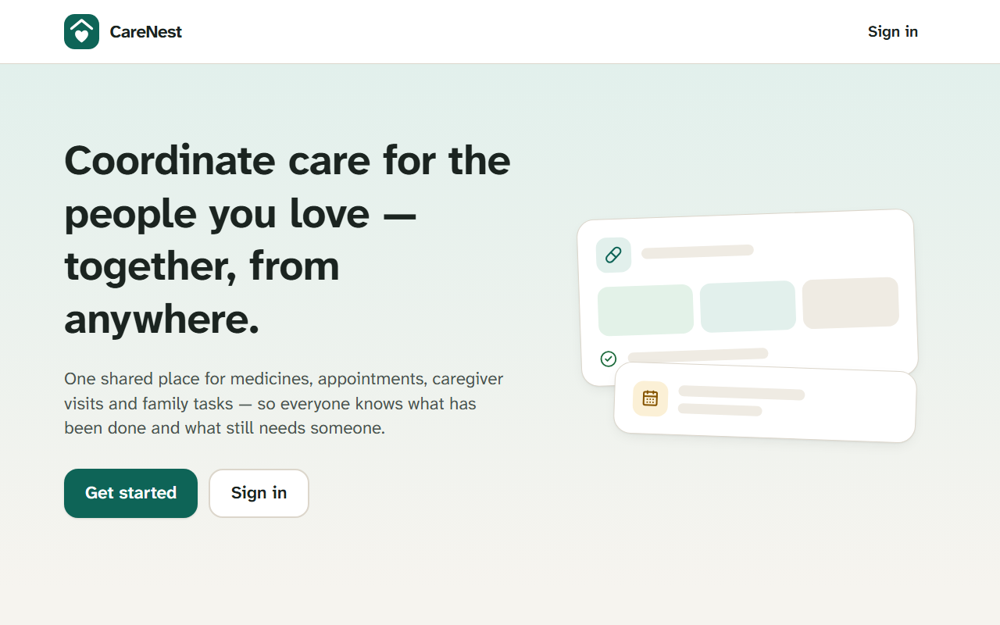

Status: **Tier 1 and Tier 2 complete** (tags `tier1`, `tier2`). Launch-readiness work (real email and SMS
providers, hosting, native-speaker translation review, legal review) is still to do. See
[docs/PLAN.md](docs/PLAN.md) for the plan, architecture, permission model and roadmap.

## A look around

### Today: what needs someone, at a glance

Every circle opens on **Today**: what needs attention (unconfirmed doses, low stock, a ride nobody has
offered), today's medicines, the next appointments and who last recorded something. The menu groups the
sections into Care, Plans, Family and Circle; the red **Help** button is always one tap away.

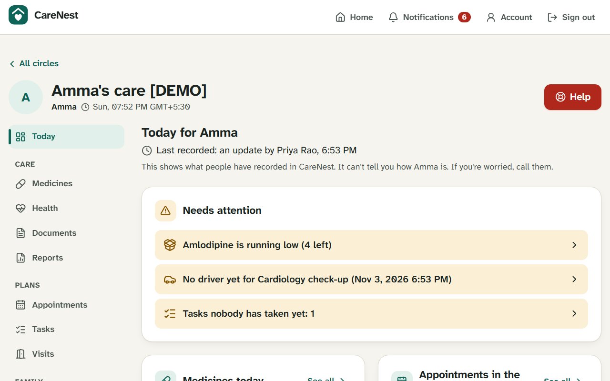

### Medicines, confirmed, never assumed

Doses are confirmed by the parent or a caregiver. An unanswered reminder shows as *unconfirmed*, never as
taken or missed, and the family is alerted.

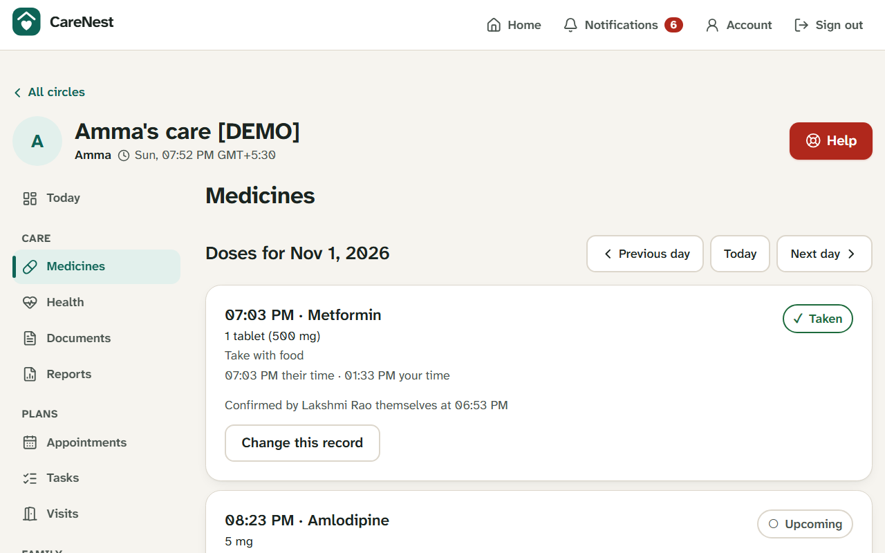

### Reports for the doctor, and shared costs

A printable care summary for any period (medicines and what happened to each dose, readings with charts,
notes), and **Expenses**, which tracks shared care costs and shows who should pay whom.

| Reports | Expenses |
|---|---|
| 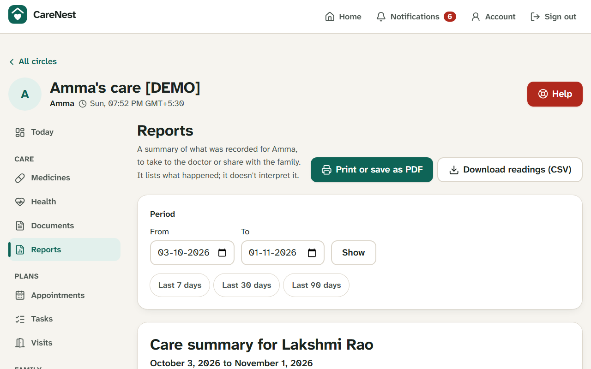 | 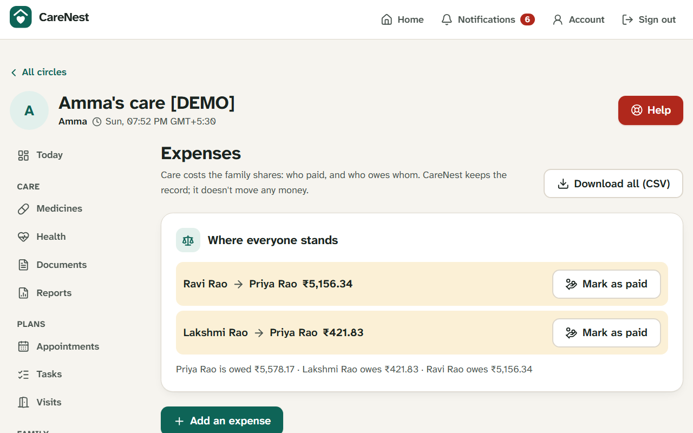 |

### Timeline and notifications

| Timeline | Notifications |
|---|---|
| 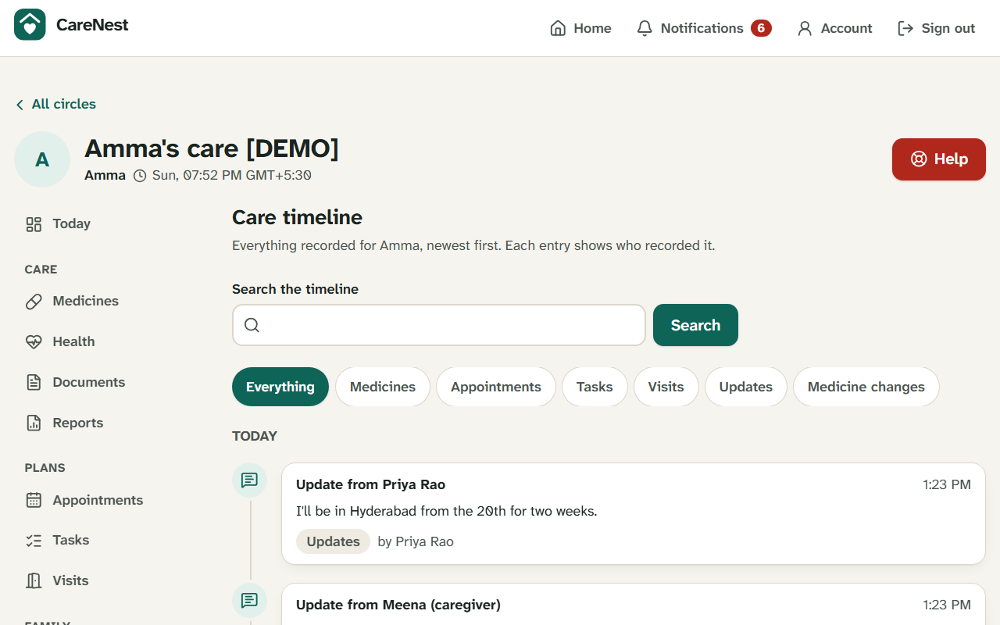 | 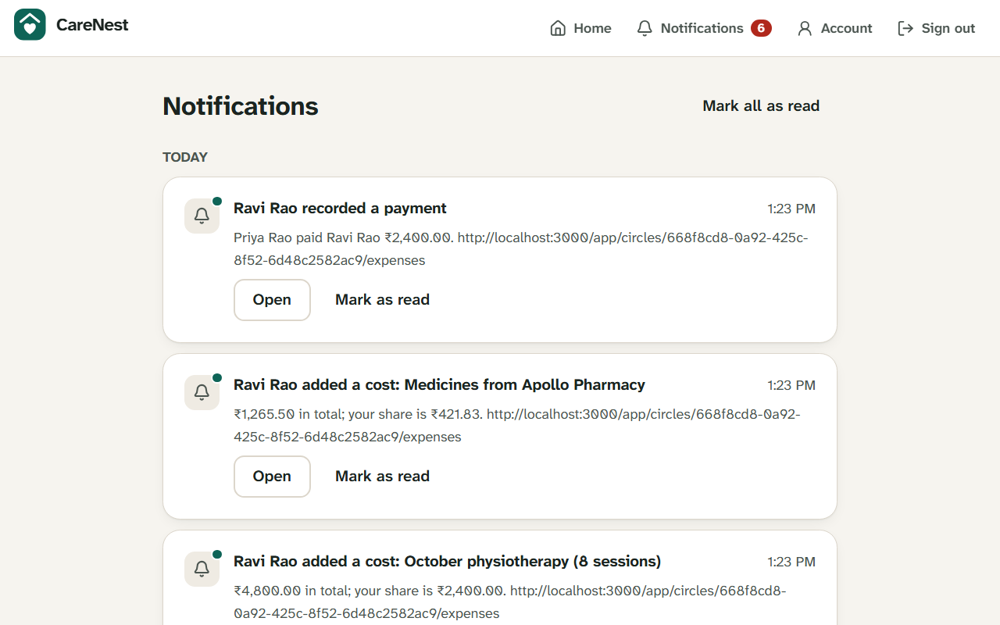 |

### Built for phones, and for parents

The parent's **Simple view** has big buttons, plain words and their own language, with read-aloud and
optional voice commands. On phones the family app moves its menu to a bar at the bottom.

<table>
  <tr>
    <th>Simple view (Telugu)</th>
    <th>Today on a phone</th>
    <th>Expenses on a phone</th>
  </tr>
  <tr>
    <td>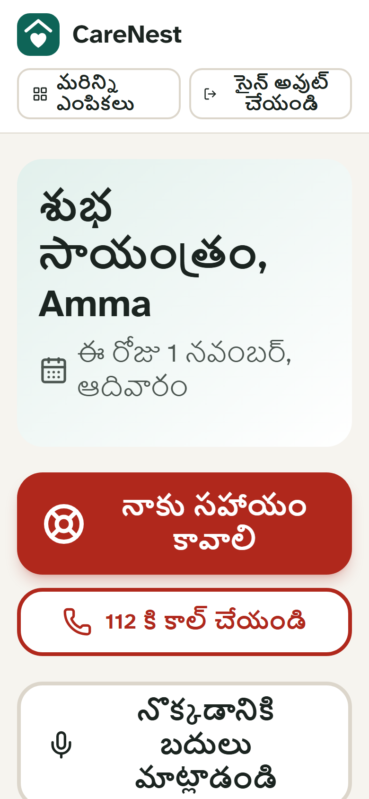</td>
    <td>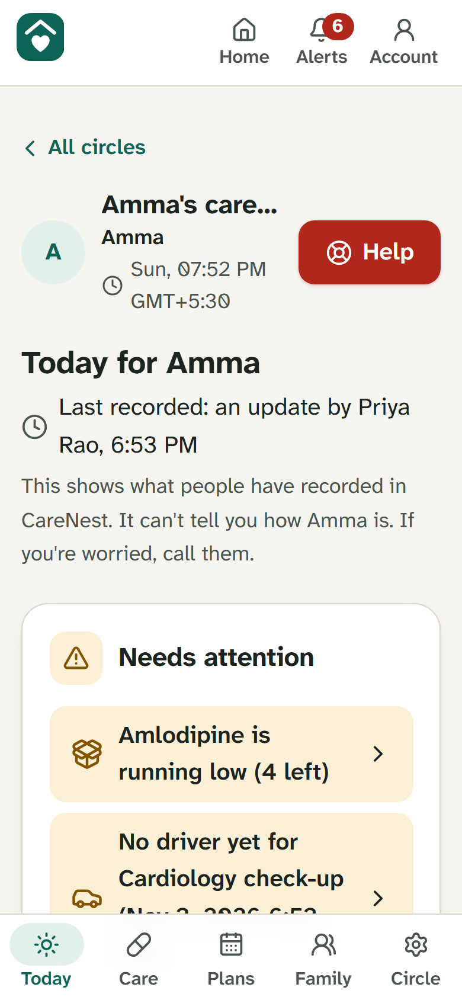</td>
    <td>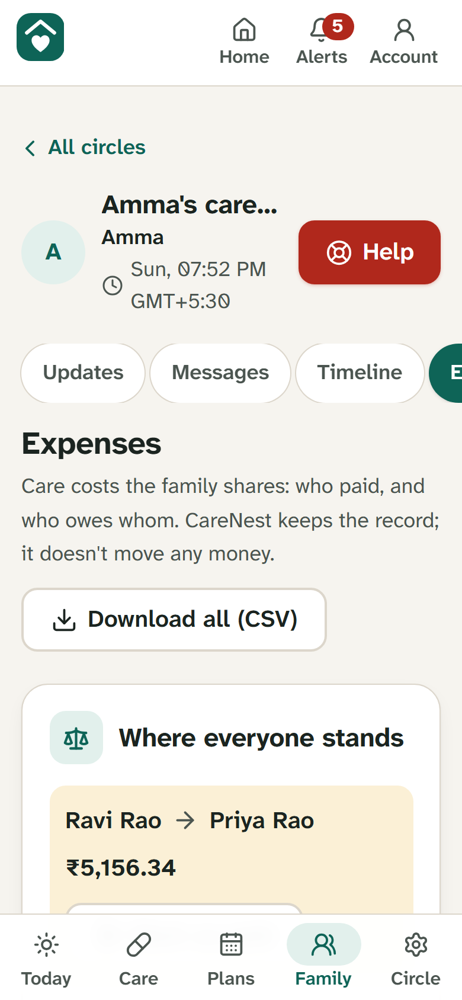</td>
  </tr>
</table>

### Dark mode

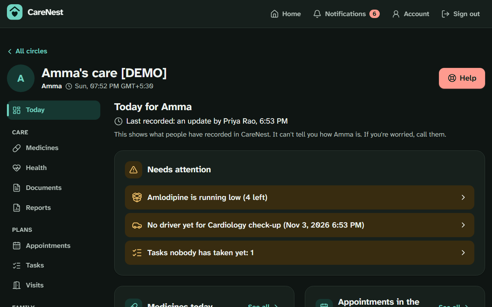

## What's in it

- **Care circles and roles:** the parent, admins, family, caregivers, clinicians and emergency contacts each
  see only what they need. The parent decides what is shared (medicines, appointments, health details).
- **Medicines:** schedules in the parent's time zone, dose confirmation, refill alerts, unconfirmed-dose
  escalation.
- **Plans:** appointments with "I'll drive", tasks with owners, caregiver visits with check-in, check-out
  and handover notes.
- **Family:** updates, conversations, a day-by-day timeline, and shared expenses with settle-up.
- **Health:** readings (blood pressure, sugar, weight and more) with charts, documents such as
  prescriptions, and printable reports. CareNest records; it never interprets.
- **Help:** a Help button that alerts the family in tiers, with the emergency card and contacts readable
  offline.
- **Alerts:** in the app, by email, as phone notifications, and by SMS (adapter built, provider not yet
  connected), with quiet hours and an evening summary.
- **Ask CareNest:** an optional AI assistant that answers from the records the asker can see, with links to
  its sources and never medical advice. It is off unless set up and turned on by whoever manages the
  circle's sharing choices.
- **Accessible:** WCAG 2.1 AA checked in light and dark mode; large text; works at phone width in all four
  languages.

## Quick start

Requirements: Node.js 22+ (24 recommended). No database server needed for development.

```bash
npm install
npm run dev          # http://localhost:3000; embedded Postgres (PGlite) in .data/, auto-migrated
```

Check it is up: `http://localhost:3000/api/health` → `{"status":"ok","database":"ok"}`.

## Demo

```bash
npm run build && PGLITE_DATA_DIR=.data/demo CRON_SECRET=demo INSECURE_COOKIES=true npm start
DEMO_URL=http://localhost:3000 CRON_SECRET=demo npm run demo:seed   # in another terminal
```

Every demo account uses the password **`carenest demo 2026`**:

| Email | Who |
|---|---|
| `priya@demo.carenest` | Priya, daughter in London, circle admin |
| `ravi@demo.carenest` | Ravi, son in the same city |
| `meena@demo.carenest` | Meena, caregiver |
| `amma@demo.carenest` | Lakshmi (Amma), the parent: Simple view in Telugu |
| `dr.iyer@demo.carenest` | Dr. Iyer, clinician |
| `neighbour@demo.carenest` | Mrs. Reddy, neighbour (emergency contact) |

Optional settings: `SMS_TRANSPORT=log` prints text messages to the console; `ANTHROPIC_API_KEY` enables
Ask CareNest. See [docs/DEPLOYMENT.md](docs/DEPLOYMENT.md) for every setting.

## Scripts

| Command | What it does |
|---|---|
| `npm run dev` | Development server |
| `npm run build` / `npm start` | Production build / server |
| `npm run worker` | Background worker (reminders, alerts, escalation, deliveries) |
| `npm run lint` | ESLint |
| `npm run typecheck` | Generate Next route types, then `tsc --noEmit` |
| `npm test` | All tests (unit + integration) |
| `npm run check` | lint + typecheck + all tests; run before every merge |
| `npm run db:generate` | Generate a SQL migration from schema changes |
| `npm run db:migrate` | Apply migrations (to `DATABASE_URL`, or local PGlite) |
| `npm run demo:seed` | Fill a running server with clearly labelled demo data |

## Testing

| Command | What it runs |
|---|---|
| `npm test` | Unit + integration tests (embedded PostgreSQL) |
| `npm run test:postgres` | The integration suite on a **real PostgreSQL** server (started automatically) |
| `npm run test:coverage` | With a coverage report in `coverage/` |
| `BLACKBOX_URL=http://localhost:3000 npm run test:blackbox` | Black-box HTTP suite against a running server, including a two-family isolation sweep |
| `npm run build && npm run test:e2e` | Browser tests in Chromium: the main journeys on desktop and phone, offline reading, voice, SMS and the assistant (with test stand-ins), phone layout in four languages, and an axe WCAG 2.1 AA scan in light and dark mode (first run: `npx playwright install chromium`) |

See [docs/TEST-REPORT.md](docs/TEST-REPORT.md) for the latest results.

## Project layout

```
src/app/            Next.js routes (pages + /api/v1 route handlers, kept thin)
src/server/         Business logic: services, auth, db, notifications, AI assistant (authorization lives here)
src/components/     Shared UI components
src/i18n/           Translations (en, hi, te, ta; hi/te/ta awaiting native-speaker review)
drizzle/            Generated SQL migrations (committed)
tests/              Integration, black-box and browser (Playwright) tests
docs/               Plan, user guide, deployment guide, test report, README images
```

## Documentation

- [User guide](docs/USER-GUIDE.md): how families, caregivers and parents use CareNest
- [Deployment](docs/DEPLOYMENT.md): Docker Compose or any Node host with PostgreSQL, the background
  worker, configuration, security checklist, backups and upgrades
- [Plan](docs/PLAN.md): product plan, architecture, permission model, roadmap and known limitations
- [Test report](docs/TEST-REPORT.md): what is tested and the latest results

## License

MIT; see [LICENSE](LICENSE).
